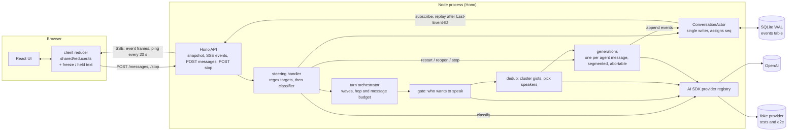
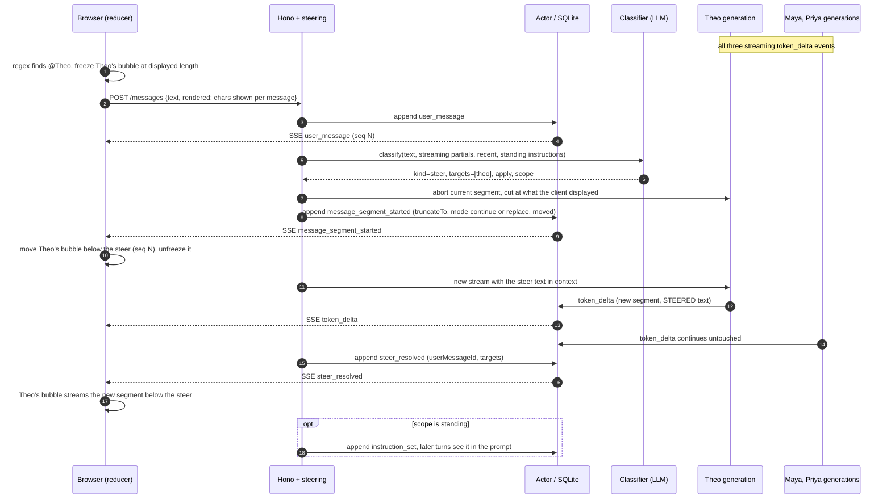

# Architecture

One Node process holds one in-memory actor per conversation. Every state change is an event appended to a SQLite log; the browser and the server both derive state by folding that log with the same reducer.

## Components

Key properties:

- **Single writer.** `ConversationActor.append` is the only place a `seq` is assigned and a row inserted. It persists, folds into `actor.view`, then notifies subscribers synchronously, so the log order is the delivery order.
- **Log is truth.** `fold(log) == actor.view`. A client that connects takes `snapshot` (view at `lastSeq`) then opens SSE from that seq; the server subscribes before replaying and dedupes by seq, so nothing falls in the gap. `Last-Event-ID` resumes after a drop. The client reducer throws `GapError` on a missed seq and refetches.
- **Display order is a fold too.** Messages show in `anchorSeq` order: the seq of their start event, or of the latest `message_segment_started` with `moved: true`. Only a user steer sets `moved` (a mid-stream restart, a debounced re-restart, or the reopen of a just-finished message), so a steered answer moves to sit after the steer that redirected it, keeping its id, its bubble and, in continue mode, the text already shown. The reducer moves the message to the end of the array, which is the same thing because a segment event is always the newest. The compliance redo, stops and unsteered agents never move anything; logs written before the field existed fold exactly as before.
- **Crash recovery.** On actor construction any message still `streaming` gets `message_aborted(server_restart)`.
- **Steering never waits on the model to be responsive.** The client freezes the visible text of a targeted agent locally (regex target parse) before the POST returns; the server's classifier decides what actually happens, then a `steer_resolved` event releases the freeze. The freeze also times out after 7 s (above the server's 6 s classifier cap).
- **Fail-soft model calls.** Gate, dedup, classifier and judge calls are structured calls with timeouts; each falls back (e.g. classifier failure treated as a plain steer to the regex targets) rather than blocking the chat.

## Mid-stream steer

"@Theo shorter" while Maya, Theo and Priya are streaming.

Variants handled by the same path: `stop` appends `stop_all` and `message_aborted(user_stop)` for the targets; a steer landing within 2 s of a finished message **reopens** it (a new segment on the same message, moved below the steer like a restart); a message with fewer than about 10 words is `replace`d rather than continued. After a steer, a one-time judge call checks the new text complied and can redo once; that redo is not a user steer, so the answer stays where it is. When one steer redirects several agents, they move in the order they were already shown.

## Event log

Source: `src/shared/events.ts`. Every row also carries `seq`, `conversationId`, `at`.

| type | payload | effect in reducer |
| --- | --- | --- |
| `user_message` | `messageId, clientMsgId, text` | adds a human message; `clientMsgId` makes POST retries idempotent |
| `message_started` | `messageId, agentId, turnId, hop, replyTo, contextCutoffSeq, effort` | opens an empty streaming agent message |
| `token_delta` | `messageId, segment, offset, text` | appends text; `offset` must equal current length |
| `message_segment_started` | `messageId, segment, contextCutoffSeq, truncateTo, mode, moved?` | supersedes the old segment; cuts text to `truncateTo`, `replace` clears it; `moved` (user steers only) moves the message to the end and sets its `anchorSeq` to this seq |
| `message_completed` | `messageId` | closes the message |
| `message_aborted` | `messageId, reason (user_stop, error, server_restart), truncateTo` | closes it, keeping text up to `truncateTo` |
| `instruction_set` | `instructionId, scope (agent or all), text` | adds a standing instruction |
| `instruction_revoked` | `instructionId` | removes it |
| `steer_resolved` | `userMessageId, targets` | invisible; tells clients to release the freeze |
| `stop_all` | `clientReqId` | stop button; idempotent on `clientReqId` |

## Ordering invariants

Checked by `tests/property/invariants.test.ts` (fast-check, random interleavings of sends, steers, stops, reloads, token arrival and 75 ms flush timers; fake timers so a flush can land on either side of any steer):

1. `seq` is gapless and strictly increasing from 1; subscribers see exactly the log.
2. `fold(log)` equals the actor's live view; snapshot plus catch-up equals the view; a fresh actor over the same DB reaches the same view.
3. Each message has one `message_started`; segments only increase; every segment closes exactly once (completed or aborted).
4. No `token_delta` after its segment is closed or superseded, and none after a `stop_all` that hit it.
5. `token_delta.offset` equals the message's current text length.
6. Every `user_message` gets exactly one later `steer_resolved`.
7. Budgets hold: hops at most 3 and at most 7 agent messages per turn.
8. When idle nothing is `streaming` and no generations are live.
9. Recovery on restart appends only `message_aborted(server_restart)` for dangling streams.
10. Display order equals messages sorted by `anchorSeq`, recomputed from the log (start seq, or the latest `moved` segment), and a `moved` segment only appears while a user message is still being decided.

## Deployment notes

- Single Fly machine with a 1 GB volume at `/data` (`DB_PATH=/data/chat.db`). Actors are in memory, so auto-stop is off and `min_machines_running = 1`; scaling beyond one machine would need sticky routing per conversation.
- SSE needs no special Fly config: the proxy passes streaming responses, the server sets `Cache-Control: no-cache` and `X-Accel-Buffering: no`, and sends `: ping` every 20 s to keep idle connections open.
- Health check: `GET /api/health` returns `{"ok":true}` (`/` redirects, so it is not usable).
- Models are env strings (`MODEL_AGENT`, `MODEL_GATE`, `MODEL_CLASSIFIER`, `MODEL_AGENT_<NAME>`) of the form `provider:model` resolved by the AI SDK registry; `fake:x` selects the scripted fake used by tests and e2e. The in-app compliance judge runs on `MODEL_CLASSIFIER`; `MODEL_JUDGE` only sets the grader for `npm run eval`, so the deployment does not set it.

## Where things live

| path | what |
| --- | --- |
| `src/shared/events.ts`, `reducer.ts`, `targets.ts` | event types, the fold used by both sides, `@mention` parsing |
| `src/server/actor.ts` | `ConversationActor`: append, view, subscribe, replay, recovery |
| `src/server/db.ts` | SQLite open, WAL, `events` table |
| `src/server/http.ts` | Hono routes: snapshot, SSE, messages, stop, health, static frontend |
| `src/server/orchestrator/turn.ts` | waves, budgets, forced replies to mentions |
| `src/server/orchestrator/gate.ts`, `dedup.ts` | who wants to speak; cluster similar gists, choose speakers |
| `src/server/orchestrator/generation.ts` | one agent message: streaming, 75 ms flush, segments, abort, reopen |
| `src/server/steering/handle.ts`, `classify.ts` | user message and stop handling; LLM steer classifier; judge |
| `src/server/agents/` | personas and prompt construction |
| `src/server/llm/` | provider registry, structured and streaming helpers, fake provider and scripts |
| `src/web/useConversation.ts` | client state: reducer, freeze, held text, pending sends, SSE and resume |
| `src/web/App.tsx`, `Bubble.tsx`, `Composer.tsx` | UI |
| `tests/` | unit, integration, property (`invariants.test.ts`), Playwright e2e against the fake |
| `evals/` | model-behavior evals (pass rates) |
