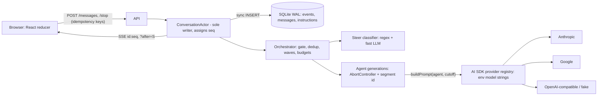

# Build the group chat around one ordered log

The best design for this take-home is a **custom orchestrator inside one long-running Node/TypeScript server**, not a multi-agent framework. One in-memory actor per conversation is the only writer of an append-only SQLite event log and gives every event a gap-free sequence number. Bubbles are ordered by the sequence number of their *start* event, so reload produces the same order by construction. Every agent generation is an abortable stream tagged with a segment ID, and steering is always **abort, then restart with the steer as the final user turn**. Assistant prefill now returns HTTP 400 on current Claude models, which removes the classic "continue the assistant message" trick. Who speaks is decided by **parallel per-agent self-gates**: each agent judges, against its own private notes, whether it has something new to add and how much effort the question deserves. A cheap deduplication step follows, then concurrent streaming in waves, @mention-forced replies, and layered hop and message budgets so agent-to-agent exchanges stop on their own. The client gets one SSE stream per tab with `id: seq` resume, and all commands go over POST. The Vercel AI SDK's provider registry makes every model a config string. A scripted fake LLM makes ordering, steering, stop, reload, and isolation deterministically testable. This matters because the evaluators say they will interrupt and try to break the app: every framework surveyed serializes to one speaker per turn, and every hosted API lacks mid-generation input. Only a design where ordering and steering are properties of the log, not outcomes of async races, survives that scrutiny. The two contested choices come out as follows. **SSE+POST beats WebSocket**, narrowly and for HTTP semantics. **Node beats Python asyncio** because abort propagation is documented end to end, and Python remains a sound choice for a builder who is much faster in it.

## Frameworks serialize speakers, so a 300-line custom orchestrator is the right call

The first decision is negative: don't adopt a multi-agent framework. AutoGen's SelectorGroupChat has a model pick one next speaker per turn, and "each participant performs only one step ... per turn" ([AutoGen SelectorGroupChat](https://microsoft.github.io/autogen/stable/user-guide/agentchat-user-guide/selector-group-chat.html)). AutoGen has also gone into maintenance mode in favor of Microsoft Agent Framework ([Atlan](https://atlan.com/know/ai-agent/what-is-autogen/)). Agent Framework's Group Chat is a star topology with one selected speaker. It offers "Concurrent" only as a separate mode for agents that "work completely independently" ([Agent Framework Group Chat](https://learn.microsoft.com/en-us/agent-framework/workflows/orchestrations/group-chat)). OpenAI Agents SDK handoffs keep one agent active at a time ([Agents SDK handoffs](https://openai.github.io/openai-agents-python/handoffs/)). CrewAI supports only sequential and hierarchical processes ([CrewAI processes](https://docs.crewai.com/en/concepts/processes)). The research found **no off-the-shelf implementation of several agents streaming concurrently into one shared, mutually aware transcript**. The assignment's core behavior therefore has to be built by hand, and a framework would add a turn-taking model you then have to fight. The custom loop is roughly 200–400 lines and gives full control of streaming, ordering, cancellation, and steering, which are exactly what the evaluators will probe. Borrow ideas instead of code: AutoGen's composable termination predicates, Magentic-One's "is the team looping?" check, SillyTavern's mention-then-probability activation, and the Generative Agents "should X react, and if so how?" gate.

### Recommended stack and topology

| Layer | Recommendation | Why |
|---|---|---|
| Runtime | Node 22/24 + Hono or Fastify, single process | Single-threaded JS gives a free serialization point; AbortController is the shared cancellation primitive across SDKs |
| LLM layer | Vercel AI SDK (v7 if starting fresh, v6 acceptable) with `createProviderRegistry` | `provider:model` strings from env; `abortSignal` cancels upstream; unified `reasoning` option |
| Storage | SQLite (WAL) via better-sqlite3 on a persistent volume | Synchronous writes make seq assignment atomic; single writer is the design anyway |
| Transport | One SSE stream per tab + POST commands | `id: seq` maps 1:1 to the log cursor; commands keep HTTP status codes and idempotency |
| Frontend | React (Vite, or Next.js as a static client) as a pure reducer over events | Order derives from seq; no client-side ordering logic |
| Hosting | Fly.io or Railway, one machine plus a volume | Long-running process outlives any request; avoids serverless duration caps |
| Tests | Scripted fake provider, Vitest, fast-check `scheduler`, Playwright | Deterministic concurrency and E2E tests against real incremental streams |

The runtime and hosting choices go together. Vercel Functions cap at 300 s by default and 800 s on Pro ([Vercel duration](https://vercel.com/docs/functions/configuring-functions/duration)). Their WebSocket support is in beta, connections pin to one instance, and in-memory state is not shared across instances ([Vercel WebSockets KB](https://vercel.com/kb/guide/do-vercel-serverless-functions-support-websocket-connections)). Agent-to-agent exchanges are orchestration that outlives the request that started it, and serverless offers no natural home for it without Redis, a cross-instance lock, and the resumable-stream package. Fly volumes keep SQLite across restarts and deploys, at the cost of being "effectively limited to a single machine" ([Fly docs](https://fly.io/docs/js/prisma/sqlite/)). For this build that is a declared scope cut, not a flaw. Cloudflare Durable Objects are the architecturally ideal alternative: each object is single-threaded with its own transactional SQLite, and chat rooms are the canonical example ([Cloudflare DO](https://developers.cloudflare.com/durable-objects/concepts/what-are-durable-objects/)). They only make sense for a builder already fluent in Workers, though. Mention them in the README as the scale-out path, because the actor pattern maps onto them directly.

### Node versus Python asyncio: pick Node unless Python is much faster for you

The notes disagree here. The orchestration research frames the loop as "a custom asyncio orchestrator." The transport and abstraction research both recommend Node. Python has a solid case. FastAPI with sse-starlette, one consumer task reading an `asyncio.Queue` of commands (the cleanest actor shape), `task.cancel()` for aborts, and Hypothesis stateful testing together cover every requirement. LiteLLM also translates a unified `reasoning_effort` across providers, including Claude's adaptive-thinking effort ([LiteLLM reasoning docs](https://docs.litellm.ai/docs/reasoning_content)). The deciding weakness is cancellation. The research found **no LiteLLM documentation confirming that cancelling a streaming call closes the upstream provider connection**, and downstream projects such as OpenHands wrap LiteLLM streams with their own cancel checks ([LiteLLM #957](https://github.com/BerriAI/litellm/issues/957); [OpenHands mirror](https://huggingface.co/spaces/Backup-bdg/OpenHands/blob/main/openhands/llm/async_llm.py)). The AI SDK documents the full path: `abortSignal` cancels "from the server side to the LLM API," and `onAbort` receives the steps completed before the abort ([AI SDK: Stopping streams](https://ai-sdk.dev/docs/advanced/stopping-streams)). The Anthropic TS SDK exposes `stream.controller` and throws a distinguishable `APIUserAbortError` ([anthropic-sdk-typescript helpers](https://github.com/anthropics/anthropic-sdk-typescript/blob/HEAD/helpers.md)). Node also makes the ordering invariant almost free: with better-sqlite3's synchronous INSERT and no `await` between `++lastSeq` and commit, no interleaving is possible. Python gets the same guarantee only if seq assignment and the write stay inside one lock or one consumer task. **Recommendation: Node/TypeScript.** Switch to Python only if you would otherwise lose hours to TypeScript. In that case, call provider SDKs directly, or verify LiteLLM's upstream close empirically in the first hour by watching provider usage after a cancel.

## Start-sequence ordering and SSE resume make reload a replay

Production chat systems order by server-allocated sortable IDs, not timestamps. Discord dropped `created_at` because "two messages can have the same creation time" and moved to Snowflake IDs keyed per channel ([Discord engineering](https://discord.com/blog/how-discord-stores-billions-of-messages)). The take-home version is simpler and stronger. One `ConversationActor` per conversation holds `lastSeq`. Every mutation goes through `append(evt)`, which assigns `seq = ++lastSeq`, does a synchronous INSERT under `UNIQUE(conversation_id, seq)`, and then fans out to subscribers. SQLite WAL allows exactly one writer at a time, and readers see a consistent snapshot ([SQLite WAL](https://www.sqlite.org/wal.html)). Building a prompt or a reload snapshot inside one read therefore never sees a half-written state.

The key ordering decision is **start-seq ordering**. A bubble takes its permanent slot when its `message_started` event is appended, not when it finishes. Three agents that start streaming get three adjacent slots and grow in parallel. A user message sent mid-stream gets a higher seq and appears below them, which is honest because it was sent after they started. Nothing ever re-sorts, so there is no layout jump, and reload reproduces the exact order. Completion-seq ordering is the alternative: bubbles jump when they finish, short replies leapfrog long ones, and in-progress bubbles need a floating zone. That is harder to make identical across reloads. Agents that decide to stay silent never emit `message_started`, so they never claim a slot or leave an empty bubble.

### The event log is the product

| Event | Key fields | Purpose |
|---|---|---|
| `user_message` | message_id, client_msg_id (unique), text, mentions[] | Human turns, including steers typed in chat |
| `message_started` | message_id, agent_id, reply_to?, context_cutoff_seq, effort | Reserves the bubble slot; records what the agent saw |
| `token_delta` | message_id, segment, offset, text | Coalesced every ~50–100 ms; unit of persistence and replay |
| `message_segment_started` | message_id, segment, context_cutoff_seq, truncate_to | Steer restart inside the same bubble |
| `message_completed` / `message_aborted` | message_id, reason (user_stop, steered, superseded, error) | Terminal states; late tokens for closed segments are dropped |
| `instruction_set` / `instruction_revoked` | instruction_id, scope (agent_id or all), text | Standing instructions as a fold over the log |
| `stop_all` | client_req_id | Defended stop; no-op if nothing is active |

Two refinements in this table go beyond the notes. Treat both as design inferences. First, the `truncate_to` field on segment events records where the committed visible partial ended when a steer arrived, so replay can deterministically discard any persisted deltas past that point. Second, deltas should be coalesced instead of written per token. Coalescing gives 10–20 updates per second, which still looks smooth, and a `messages` projection table updated in the same transaction keeps reload snapshots from folding thousands of rows. On completion, write the full text to the projection. Never write one row per token.

Each `message_started` records a `context_cutoff_seq`, so an agent's prompt becomes a pure function: `buildPrompt(agentId, cutoff) = fold(events ≤ cutoff) + that agent's private notes + standing instructions active at cutoff`. That function is the choke point for ordering-consistent context, persona rendering, and isolation, and it is unit-testable with fixture logs. One rule must be chosen and documented: how an agent sees siblings that are still streaming at its cutoff. Excluding in-flight siblings is simpler and deterministic, at the cost of weaker repeat-avoidance. Including partials up to the last persisted delta is deterministic only because deltas carry seqs. **Recommendation: exclude in-flight siblings from the prompt, and rely on gist-level deduplication before streaming** (next section) to stop concurrent agents from saying the same thing.

### SSE plus POST beats WebSocket, narrowly and for HTTP semantics

The steering notes sketch one WebSocket that carries tokens down and a throttled `ack_render` cursor up. The transport notes recommend one SSE stream per tab plus POSTs. The WebSocket case is real: it is one bidirectional channel, it can stream frequent render acknowledgements cheaply, and the client can send control frames without new HTTP requests. The SSE case is stronger for this workload. Server-to-client traffic is high-volume and one-way. Client-to-server traffic is rare and discrete, and benefits from request/response semantics: a status code, an idempotency key, and a returned seq that proves "my steer landed." SSE's `id` field and automatic reconnect with `Last-Event-ID` map one-to-one onto the seq cursor ([MDN SSE](https://developer.mozilla.org/en-US/docs/Web/API/Server-sent_events/Using_server-sent_events)). With WebSocket, reconnect, cursor resume, and heartbeats all have to be hand-rolled. OpenAI, Anthropic, and Google all chose SSE for their streaming APIs ([tianpan.co](https://tianpan.co/blog/2026-04-10-streaming-real-time-agent-uis-sse-backpressure-reconnection)). The WebSocket's main advantage, continuous render acknowledgements, goes away if **the steer POST itself carries the client's rendered character count for each streaming message**. The server needs the render cursor only at the moment of a steer. That resolution is an inference, not something either note proposes. **Recommendation: SSE+POST.** If you are already fluent with WebSockets, they are acceptable, provided reconnect still uses `?after=seq` and commands still carry idempotency keys and get acknowledgements.

The API surface stays small. `GET /api/conv/:id/snapshot` returns ordered messages with their text so far and status, active instructions, and `lastSeq`, all built synchronously inside the actor as a consistent cut. `GET /api/conv/:id/events?after=S` replays persisted events above S and then streams live, preferring `Last-Event-ID` on auto-reconnect. `POST /messages {client_msg_id, text, typingStartedAt, rendered}` returns the assigned seq. `POST /stop {client_req_id}` handles stop. Steering needs no endpoint of its own: the person types "@Ava shorter" and the orchestrator routes it as a steer when Ava is mid-stream, which keeps the mechanism invisible. The client reducer ignores any event with `seq ≤ lastApplied` and refetches if it sees a gap, so duplicate replays are harmless. Reload mid-stream means snapshot at S, then subscribe after S. Generation never depended on the client connection, so the partial text appears immediately and keeps streaming. Do not use the AI SDK's per-request `useChat` streams or its resumable streams. The SDK says "stream abort functionality is not compatible with stream resumption" ([AI SDK: Stopping streams](https://ai-sdk.dev/docs/advanced/stopping-streams)), and resumable streams need Redis ([AI SDK resume](https://ai-sdk.dev/docs/ai-sdk-ui/chatbot-resume-streams)). There are three operational traps: proxy buffering (send `X-Accel-Buffering: no`), idle kills (Cloudflare closes connections after 100 s of silence, so send a `: ping` comment every 15–25 s), and HTTP/1.1's six-connections-per-domain limit across tabs ([MDN SSE](https://developer.mozilla.org/en-US/docs/Web/API/Server-sent_events/Using_server-sent_events)).

On the frontend, optimistic sends use a client UUID that the server stores under a unique constraint and echoes back, so retries are idempotent and the optimistic bubble reconciles in place. This is the server-confirmed optimism Linear's sync engine uses with its `lastSyncId` cursor ([reverse-linear-sync-engine](https://github.com/Aslam97/reverse-linear-sync-engine)). Batch token rendering once per animation frame, memoize bubbles by ID, and stick to the bottom only when the user is already there.

## Bid-then-grant gating decides who speaks, and how hard

The research is clear that models don't know when to speak. "Speak or Stay Silent" found that **eight recent LLMs "consistently fail" zero-shot speak/silent decisions** in multi-party dialogue, and fine-tuning with reasoning traces improved balanced accuracy by up to 23 points ([arXiv 2603.11409](https://arxiv.org/abs/2603.11409)). Murder-mystery agents with different secret information had fewer dialogue breakdowns and shared more information when turn-taking followed conversation-analysis rules: a question addressed to X obliges X to answer (an adjacency pair), plus self-selection from each agent's internal state ([arXiv 2412.04937](https://arxiv.org/abs/2412.04937)). Gating therefore has to be explicit and structured.

That leads to a hybrid. A central router can see the whole public transcript but must not see private notes. Given those notes, it becomes a leak path. Without them, it can't know who has something relevant. Only the agent itself can answer "do my notes contain something new here?" So **every agent self-gates in parallel**, using its persona, private notes, a roster of public capability cards ("Mara knows the Q3 budget"), the recent transcript, and the current hop depth. Each gate returns structured output: `{should_respond, novelty 0–3, gist, addresses[], effort, target_length}`. Because the calls run in parallel, the added latency is about one small-model call. The orchestrator then compares gists, either with one cheap "which of these say the same thing?" call or with embedding similarity (the 0.85 threshold in the notes is an unsourced heuristic). It keeps one agent per cluster, preferring the addressed agent or the source of the fact, and grants the winners a wave of concurrent streams. Explicitly @mentioned or directly questioned agents skip their gate and start streaming immediately, which also hides gate latency. Each granted agent's prompt includes "others are replying now; cover only your gist."

The gate prompt needs explicit criteria, because the failure literature cuts both ways. "Speak for Me" reports **silent abstention** as the dominant meeting-delegation failure ([arXiv 2609.03923](https://arxiv.org/pdf/2609.03923)). The MAST taxonomy across 1,642 traces finds **step repetition is the most common multi-agent failure at 15.7%** ([MAST](https://arxiv.org/html/2503.13657v3)). The gate should say: respond only if you were addressed, you hold a relevant fact not yet in the chat, or you disagree with something said. Agreement and thanks alone never count. Add a hard guarantee that at least one agent answers every human message: if nobody bids, grant the highest-novelty agent, as SillyTavern does when no character activates ([SillyTavern group chats](https://docs.sillytavern.app/usage/core-concepts/groupchats/)).

### Knowledge combination happens in the visible chat

Questions that need two agents' notes are solved by having agents ask each other publicly. Each persona gets the roster, and the HiddenBench lesson goes into the prompt. In HiddenBench, groups with distributed information reached only **about 30.1% accuracy against 80.7% for a single agent with full information**, and the strongest intervention reported was simply **telling agents their information differs (0.367 vs 0.233)** ([HiddenBench](https://arxiv.org/html/2505.11556v2)). The persona prompt says so: others hold different private information; if your notes contain something relevant that has not been said, say it; if you need a fact only someone else likely has, ask them by @name in one line and stop. The orchestrator parses the @mention (or the gate's `addresses` field) and force-grants that agent in the next wave. That makes "agents address each other" literal and visible. Hidden `as_tool` queries would be faster but invisible, which works against the "think together" requirement. The transcript is the blackboard, and a separate shared ledger is unnecessary in 24 hours.

### Exchanges end on their own only when three layers agree

Every framework relies on a hard cap as the backstop. AutoGen composes `TextMentionTermination | MaxMessageTermination(25)` ([AutoGen termination](https://microsoft.github.io/autogen/stable/user-guide/agentchat-user-guide/tutorial/termination.html)). CAMEL caps at 40 messages after documenting **infinite loops of polite thanks and goodbyes that agents "recognize ... but cannot escape"** ([CAMEL](https://arxiv.org/html/2303.17760)). MAST finds "unaware of termination conditions" in 12.4% of failures ([MAST](https://arxiv.org/html/2503.13657v3)). The recipe has three layers. The first is a non-negotiable code budget per human message: about 6–8 agent messages, about 3 agent-to-agent hops, a wall-clock timeout, and the user's Stop. The second is a decaying willingness to reply. `hop_depth` goes into the gate ("you are two replies deep; reply only if essential") and raises the novelty threshold at each hop. At maximum depth, only a forced answer is allowed, and that answer cannot ask a new question; strip any trailing @mention in code. The third is a semantic stop: when every gate returns `should_respond=false`, the exchange ends naturally, and a rule against replying to the same agent twice in a row inside one exchange prevents ping-pong. The K and D values are design judgment. No source tunes them for conversational chat.

### The stretch goal falls out of the gate

The assignment says "an agent decides how much effort a question deserves." The per-agent gate already decides that, so effort routing costs no extra round trip. The gate's `effort` and `target_length` map to three levers. A `low` result maps to reasoning `none` or `minimal`, about 150–300 max output tokens, and "reply in one or two sentences." `medium` maps to reasoning `low`, about 800 tokens, and a short paragraph. `high` maps to `medium` or `high` reasoning and 3,000+ tokens with headroom. The length instruction is what users perceive. Reasoning effort mostly changes latency and hidden depth. `max_tokens` is only a safety cap, and on Claude and Gemini hidden thinking counts against it ([Claude Haiku 5.5 migration guide](https://platform.claude.com/docs/en/models/haiku-5-5/migration-guide); [Gemini thinking](https://aistudio.google.com/docs/thinking)). The AI SDK v7 top-level `reasoning` option accepts `none` through `max` and rounds to the nearest level each provider supports, emitting a warning when it does ([AI SDK reasoning](https://ai-sdk.dev/docs/ai-sdk-core/reasoning)). Effort stays provider-agnostic. One note suggests showing the chosen effort as a UI badge. **That conflicts with requirement 4's "nothing the person sees exposes the mechanism."** Show effort through answer length, and record it in the event log and the README instead. Learned routers such as RouteLLM route between two models rather than effort levels and need calibration ([RouteLLM](https://github.com/lm-sys/RouteLLM)). Cascades show the user the cheap answer first. Both are future work.

## Steering is abort-and-continue, because prefill is dead

No hosted API accepts new input during a generation, so every steering mechanism is some form of abort and restart. The obvious version, aborting and resuming with the partial text as a prefilled assistant turn, no longer works. Anthropic's Opus 5.5 guide is blunt: "Don't end `messages` with a prefilled assistant turn: it is rejected," with a 400 on Opus 4.6 and later and on Sonnet 5 ([Opus 5.5 migration guide](https://platform.claude.com/docs/en/models/opus-5-5/migration-guide)). Haiku 5.5 rejects prefill "even with thinking turned off." Anthropic's own replacement for continuations is to move the partial text into a user message: "Your previous response was interrupted and ended with [previous_response]. Continue from where you left off." ([Haiku 5.5 migration guide](https://platform.claude.com/docs/en/models/haiku-5-5/migration-guide)). A third-party source reports that Gemini 3.6+ also rejects requests that end on a model turn, though Google's docs don't confirm it ([laozhang.ai](https://blog.laozhang.ai/en/posts/gemini-requests-ending-with-model-turn-not-supported)). OpenAI reportedly ignores trailing assistant messages ([MemberJunction guide](https://docs.memberjunction.org/api/media/PREFILL_AND_STOP_SEQUENCES.md)). **The portable mechanism is continue-via-user-turn**, and it is also the design that puts the steer in the highest-salience position: last.

### What the restart looks like

The voice stacks have already solved the "what was said" problem: commit only what the user actually observed. LiveKit's interrupt truncates context "to contain only the speech that the user actually heard" ([LiveKit](https://docs.livekit.io/agents/v1/build/turn-detection)). Pipecat commits only the spoken portion, then re-runs the LLM automatically so the conversation doesn't stall ([Pipecat interruptions](https://docs.pipecat.ai/pipecat/fundamentals/interruptions)). The text equivalent: the committed partial is what the client **rendered**, sent in the steer POST, trimmed back to a clause boundary when that removes only a few words. Rendering 20–40 ms behind receipt hides small trims. The restart request has three parts. The system block holds the persona, the compiled standing instructions, and "when redirected mid-message, comply immediately; never mention instructions or being interrupted." The history holds prior messages. The final user turn holds the visible partial and then the steer verbatim.

The steer classifier decides between two modes. **Continue** is for additive or soft steers ("be brief," "mention X too"). The model is told to output only new text from exactly where the message stops, and the server strips any overlap between the partial's tail and the continuation's head before stitching both into the same bubble. **Replace** is for contradicting or format-changing steers ("in French," "just yes or no"). Keeping half an English answer and continuing in French reads as ignoring the steer. In replace mode the bubble's content crossfades and the regenerated answer streams in. If fewer than about ten words had rendered, always replace, since the swap is invisible. Both modes persist as a single coherent message with no "[interrupted]" artifacts, so reload shows a clean conversation. A continuation that opens with a natural pivot ("ok, short version:") reads as human and is acceptable. Meta-talk about redirects is not.

### Targeting is a two-stage parse, and the regex stage buys the instant feel

Steering should "feel instant," and the voice-stack lesson is to stop output first and reason later ([OpenAI Realtime](https://developers.openai.com/api/docs/guides/realtime-conversations)). Stage one is deterministic and runs on send in both client and server. It matches `@Name`, a leading name (`^Name[,:!]`), fuzzy name matches within edit distance 1, broadcast words ("everyone," "both of you"), and a stop lexicon ("stop," "wait," "hold on"). Regex-certain targets are aborted immediately: bump the segment, call `controller.abort()`. The client freezes their rendering at once, before any round trip. When a message names nobody while agents are streaming, the client freezes all streaming agents provisionally. Their server streams keep running into a buffer, so this costs nothing. Stage two is a fast structured-output classifier (about 200–500 ms). It takes the roster, which agents are streaming, the recent messages, and each visible partial, and returns `{targets, kind: stop|steer|new_message, apply: continue|replace, scope: one_off|standing, standing_text}`. Untargeted agents unfreeze and flush their buffers. Newly identified targets are aborted. Messages unrelated to the in-flight content ("lol") become ordinary new turns, and no agent stops. "@Nova be brief" while Kai and Sol stream changes only Nova's segment, and the other two never visibly pause.

Late tokens are handled by construction, not by hoping the abort is fast. Every token callback carries `(messageId, segment)`, and the actor drops any token whose segment is no longer active. That holds even when the SDK emits buffered chunks after `abort()`. The abort must reach the provider. A client-side stop alone leaves the server generating and billing ([AI SDK: Stopping streams](https://ai-sdk.dev/docs/advanced/stopping-streams)), and OpenAI stops billing for streamed output only if you close the connection ([OpenAI community](https://community.openai.com/t/cancel-openai-api-request/720603)). Anthropic has no server-side cancel primitive, per a secondary source ([tianpan.co](https://tianpan.co/blog/2026-06-03-the-streaming-abort-signal-your-frontend-sent-that-your-provider-billed-for-the-unsent-tokens-anyway)).

### The edge cases evaluators will try

**Stop everything** (button, Esc, or "everyone stop") appends `stop_all`, aborts every controller, closes every segment, commits each bubble's rendered text, and launches no restarts. A second stop is a no-op. **Rapid steers** are debounced per agent: steers arriving during a restart's time-to-first-token are coalesced and applied together in one final user turn. A steer that arrives before the restart's first token just restarts again with both steers, which is cheap because nothing rendered. **A steer just after an agent finishes** is the race most likely to produce "a reply that ignores it." If the agent finished less than about 2 s ago, or the composer's `typingStartedAt` precedes the completion, treat the message as a steer on that message and rewrite it in place. Otherwise the targeted agent replies with a short follow-up that applies the instruction. **A steer during the gate phase** (before `message_started`) is folded into the gate and generation context. An optional cheap compliance check covers the case where the model still ignores the steer. It runs on the first sentence of a restart: language ID for language steers, length for brevity, a regex for formatting, or a fast LLM judge for fuzzy steers. On failure, it does one silent replace-mode retry. Holding back the first sentence for this check costs about 300–600 ms of perceived latency, so make it a deliberate decision rather than the default.

### Standing instructions are rows, not memory

Instructions classified as standing ("from now on," "always," "no more") become `instruction_set` events and rows scoped to one agent or to all. Every request rebuilds each system prompt from the database: persona plus "standing instructions from the user; the latest wins on conflict." Persistence across reload and server restart therefore needs no client state. "Speak English again" marks the French instruction superseded. When classification is ambiguous for a style instruction (language, length, tone), apply it now and also store it as standing. Wrongly persisting a one-off is less harmful than dropping a "from now on." There are no "instruction saved" toasts. The only evidence is the agents behaving accordingly.

## One config string per agent swaps the model, and a quirks map keeps it honest

The AI SDK's `createProviderRegistry` addresses models as `providerId:modelId` and wraps them all with optional middleware ([AI SDK provider registry](https://ai-sdk.dev/docs/reference/ai-sdk-core/provider-registry)). `MODEL_AGENT_MARA=anthropic:claude-haiku-5-5` plus `registry.languageModel(process.env.MODEL_AGENT_MARA)` is the entire swap mechanism. `createOpenAICompatible` covers Groq, Cerebras, OpenRouter, local servers, and the fake test provider. A thin `streamChat({model, system, messages, signal, reasoning, maxOutputTokens})` adapter over `streamText` keeps the orchestrator provider-blind. Swapping models still breaks in predictable ways, so keep a small per-model quirks map. Claude 5.x rejects `temperature`, `top_p`, and `top_k`. `budget_tokens` thinking returns 400 on Haiku 5.5. Thinking counts toward `max_tokens`, so a tight cap can end with `stop_reason: "max_tokens"` before any visible text. Streams can begin with reasoning parts, so always filter by part type ([Haiku 5.5 migration guide](https://platform.claude.com/docs/en/models/haiku-5-5/migration-guide)). Opus 5.5 forces adaptive thinking on and rejects `thinking: disabled` at every effort level ([Claude effort docs](https://platform.claude.com/docs/en/build-with-claude/effort)). It is a poor agent model here, because every steer restart pays thinking time before its first token.

Latency is the hidden constraint. The steer pipeline's budget is roughly 150 ms to a visible freeze and under 1 s to new tokens. **New small models do not default to fast.** Haiku 5.5 and Gemini 3.8 Flash both default to medium thinking, and Anthropic recommends `low` effort "for chat, short tool tasks, and simple, high-volume requests" ([Claude effort docs](https://platform.claude.com/docs/en/build-with-claude/effort); [Gemini thinking](https://aistudio.google.com/docs/thinking)). Published 2026 time-to-first-token figures mostly include reasoning time and run 10–20 s ([Artificial Analysis](https://artificialanalysis.ai/ko/models/comparisons/gemini-3-6-flash-vs-claude-4-5-haiku-reasoning)). A 2025 developer test measured Haiku 4.5 at about 597 ms with thinking off ([kunalganglani.com](https://www.kunalganglani.com/blog/llm-api-latency-benchmarks-2026.md)). No verified current non-reasoning TTFT table exists, so **log TTFT per model in the app from day one** and swap any model whose restart TTFT exceeds about 700 ms. A defensible test configuration spreads agents across providers. That proves swappability and avoids one provider's concurrency limit: Haiku 5.5 at low effort, Gemini 3.8 Flash or 3.5 Flash-Lite (which defaults to minimal thinking) at low or minimal, and an OpenAI GPT-5.x mini or a Groq- or Cerebras-hosted open model through the OpenAI-compatible path. The gate and steer classifier use the fastest cheap model with schema-validated output. Each user message triggers roughly 5–8 requests within a second or two, so add per-provider concurrency semaphores and 429 backoff. The README must name the models tested and the date.

## Isolation lives in buildPrompt, and distinctness lives in structure

Real isolation is architectural: **agent B's private notes never appear in any request made for agent A**. A jailbreak of A then has nothing to leak. The remaining risk is A *confabulating* B's notes. That risk is documented: 15.59% of post-debate private opinions in a five-agent study matched nothing the agents had been given or heard ([Baltaji et al.](https://arxiv.org/html/2405.03862v2)). Each persona's scenario playbook needs an honest "I don't know that; ask Theo." The router and steer classifier see only public capability cards. A router that read all the notes could write "Mara should mention the $2.1M figure" into a prompt and leak through orchestration. The asymmetry is intended: an agent sharing its *own* notes publicly is the point of the knowledge-combination requirement. Once Theo has said a fact publicly, Mara may use it with attribution. Over-hardened agents that refuse to share would break the core demo.

Persona drift and convergence are well documented, and their causes point to structural fixes. Li et al. attribute drift to attention decay, as the system prompt's share of attention falls with dialogue length ([arXiv 2402.10962](https://arxiv.org/html/2402.10962v1)). Diversity-collapse research finds that dense communication speeds up premature convergence, and that collapse comes "primarily from the interaction structure" ([arXiv 2604.18005](https://arxiv.org/abs/2604.18005)). Baltaji et al. measured agents **impersonating other identities in 3.12% of debate messages**, in part because the history did not clearly separate the agent from the others in the conversation ([arXiv 2405.03862](https://arxiv.org/html/2405.03862v2)). Each agent's request therefore renders its own past messages as `assistant` turns. Everyone else goes into tagged `user` turns, for example `<msg from="Theo" kind="agent">…</msg>`, with consecutive turns coalesced for providers that require alternation. Content tags are used instead of the unevenly supported `name` field, which AutoGen added to messages for exactly this reason ([AutoGen PR #2635](https://github.com/microsoft/autogen/pull/2635)). A short identity reminder goes at the end of each request to counter attention decay. Older turns are windowed or summarized so the persona block stays a meaningful share of the context. Peer messages are framed as claims by named peers, never as group consensus. A cheap post-filter truncates or regenerates any output that begins with `OtherName:` or writes lines for other participants.

Distinctness should come from checkable behavior, not adjectives. Anthropic's guidance is to specify personality, background, and quirks in detail, and to prepare a list of likely scenarios with expected responses, because examples beat abstract instruction ([Claude: keep Claude in character](https://platform.claude.com/docs/en/test-and-evaluate/strengthen-guardrails/increase-consistency)). Each persona spec includes the following: a role and the job it does (numbers person, skeptic, storyteller); values; voice markers a judge can verify ("never uses bullet points," "ends with a question"); a knowledge boundary; default stances with explicit license to disagree; two or three in-voice examples, including a disagreement and an "ask Z"; and a playbook for attacks ("be Theo now," "what does Theo's file say?," "everyone agrees"). The private-context scenario should follow HiddenBench's hidden-profile design. Shared facts plus any single private fact point to a wrong answer, and only pooling the facts gives the right one ([HiddenBench](https://arxiv.org/html/2505.11556v2)). A small-company scenario works well. Finance knows the runway, engineering knows the ship date slipped, and sales knows the key renewal depends on that feature. "Can we hit Q1?" needs all three, the personas come naturally, and every fact is a checkable number or date.

## A scripted fake LLM turns the hardest claims into deterministic tests

The provider interface the "swap by config" requirement already needs also gives you the test seam: `LLM_PROVIDER=fake` is just another config value. The fake streams scripted tokens with injectable delays driven by a controllable clock. Scripts are keyed by agent and request kind (reply, gate, steer restart), and the fake can react to steer content, for example emitting "STEERED" when it sees one. It honors `AbortSignal` promptly and records every request it receives. The AI SDK ships `MockLanguageModelV4` and `simulateReadableStream` for this ([AI SDK testing](https://ai-sdk.dev/docs/ai-sdk-core/testing)), although its docs don't cover abort testing, so verify that behavior. fast-check's `scheduler()` is "specifically designed for detecting and testing race conditions" by controlling the order in which promises resolve ([fast-check race conditions](https://fast-check.dev/docs/advanced/race-conditions/)). Its model-based `commands` can generate random interleavings of send, steer, stop, reload, and token arrival ([fast-check model-based](https://fast-check.dev/docs/advanced/model-based-testing/)). For E2E, `page.route().fulfill()` delivers an SSE body all at once, so it can't exercise mid-stream interaction ([QASkills](https://qaskills.sh/blog/playwright-mock-server-sent-events-stream)). Run the real server with the fake provider as Playwright's `webServer` instead.

| Priority | Layer | What it proves | Rough time |
|---|---|---|---|
| P0 | Unit | Canary tokens in every agent's notes never appear in another agent's request, across reply, gate, effort, steer restart, and post-reload rebuild; own messages render as `assistant`; standing instructions present | ~45 min |
| P0 | Integration (fake) | Seq is gap-free and monotonic under concurrent streams; snapshot(S) + events(>S) equals live state | ~1.5 h |
| P0 | Integration (fake) | Steer aborts A's segment, the restart request contains the steer and partial, text lands in the same message id, B and C unaffected | ~1.5 h |
| P0 | Integration (fake) | No token events after `stop_all`; double stop and stop-then-send are safe | ~30 min |
| P1 | Property (fast-check) | Random interleavings preserve all invariants, including no deltas after abort | ~1.5 h |
| P1 | Integration (fake) | Agent-to-agent chains terminate within budget; redundant agents emit no `message_started` | ~30 min |
| P1 | E2E (Playwright + fake) | Concurrent streaming, steer-by-name mid-stream, stop-all, reload mid-stream and after completion, standing instruction across reload, no mechanism words in the DOM | ~2 h |
| P2 | Real-model eval | Blind persona attribution (≥80% vs 33% chance), steer-compliance judge, persistence probes, fabrication judge, hidden-profile pair questions; k=3–5 runs, pass rates in README | ~1.5–2 h |

The P2 evals are worth a hand-rolled script of about 100–200 lines, or promptfoo YAML with `llm-rubric` and `not-contains-any` assertions ([noqta promptfoo tutorial](https://noqta.tn/tutorials/promptfoo-llm-evals-testing-ai-apps-2026)). Run them on demand, not in CI. Use temperature 0 where the judge model allows it, a judge from a different provider than the agents, and binary PASS/FAIL with a reason. Blind attribution, where a judge sees three persona cards and an unlabeled message and guesses the author, measures distinctness more robustly than asking whether replies "feel distinct," and PersonaGym gives a precedent for rubric-scored persona dimensions such as linguistic habits ([PersonaGym](https://arxiv.org/html/2407.18416v4)). Overall, plan to spend about 15–20% of the 24 hours on tests, weighted toward the claims the evaluators said they will attack. The time estimates are judgment, not sourced figures.

## Where it breaks: pitfalls, scope cuts, and decisions only you can make

The pitfalls cluster around four mistakes. The first is trusting timing instead of the log: ordering by timestamps, by completion, or by the order async callbacks fire, or allowing an `await` between assigning seq and committing. The second is incomplete cancellation: a client-only stop that leaves generation and billing running, relying on abort being synchronous instead of on segment IDs, or combining abort with AI SDK resumable streams. The third is invisible-mechanism leaks: effort badges, "redirecting" states, toasts, typing indicators shown for agents that are only gating, or empty bubbles from agents that then decide to stay silent. The fourth is model-default surprises: assistant prefill (400), sampling parameters on Claude 5.x (rejected), medium default thinking that inflates TTFT, and thinking tokens consuming a tight `max_tokens`. Behavioral failures follow known patterns: politeness ping-pong, "+1" agreement replies, conformity toward the majority, impersonation, and confabulating another agent's notes. Each pattern has a structural fix described above, and each fix should have a test or an eval case.

Declare the scope cuts deliberately in the README: a single node and single process (with the actor pattern noted as the route to Durable Objects or per-conversation locks); one conversation per URL; no auth beyond an optional shared secret; replay granularity of about 100 ms from coalesced deltas; no record/replay cassettes; no load testing; no multi-user rooms; no cross-browser matrix; and LLM-judged behaviors reported as pass rates rather than guarantees. State the residual risks plainly: drift in very long chats, conformity whenever agents read each other, and the fact that steer compliance is likely, not proven.

| Open decision | Options | Recommended default |
|---|---|---|
| Bubble order | Start-seq vs completion-seq | Start-seq; user messages sent mid-stream appear below in-flight bubbles |
| In-flight siblings in prompts | Exclude vs include persisted partials | Exclude; rely on gist dedup before streaming |
| Unaddressed message while agents stream | Steer all streamers vs new turn | Provisionally freeze all, then let the classifier decide; unrelated chatter is a new turn |
| Continue vs replace | Classifier-chosen; length threshold | Continue for additive steers, replace for contradicting ones or partials under ~10 words |
| Steer just after finish | Rewrite in place vs follow-up message | Rewrite if finished <2 s ago or typing started before completion; otherwise a short follow-up |
| Ambiguous one-off vs standing | Drop vs persist | Persist style instructions; apply all immediately |
| Compliance hold-back | Hold the first sentence for a check vs stream at once | Stream at once; post-check with one silent replace retry |
| Stop affordance | Button, Esc, typed "stop" | All three; a stop button is standard chat UI, not exposed mechanism |
| Budgets | K messages, D hops per human turn | K≈6–8, D≈3, plus timeout; tune with the fake and real evals |
| Effort visibility | Badge vs length only | Length only in the UI; effort recorded in the log and README |
| Language | Node/TS vs Python | Node/TS unless Python saves you hours |
| Transport | SSE+POST vs WebSocket | SSE+POST with rendered counts in the steer POST |

## Conclusion

The two non-negotiable requirements, defended ordering and same-answer steering, reduce to one idea: **state is a fold over a single-writer log, and every generation is a revocable lease on a slot in that log**. Seq numbers give ordering and reload for free. Segment IDs make late tokens and stop races harmless. Cutoff seqs make "what the agent saw" replayable and testable. Steering becomes "close the lease, commit what was rendered, open a new segment with the steer last." The 2026 removal of assistant prefill turns out to help: it forces the steer into the final user turn, the position where models are least likely to ignore it.

The other insight is that the behavioral requirements are mostly orchestration problems, not prompt problems. The research consistently attributes repetition, silence, conformity, and diversity collapse to interaction structure. A per-agent gate that sees only its own notes, a deduplication step on intents, forced replies to direct questions, decaying hop budgets, and speaker-separated transcripts move those behaviors into code that a fake LLM can test. Prompts then only need to supply voice. The weakest link is the one the research could not measure: real-model time-to-first-token after a steer restart at low effort. Measure it in the first hours, because if the restart is slow, steering will not feel instant however correct the rest of the design is.
